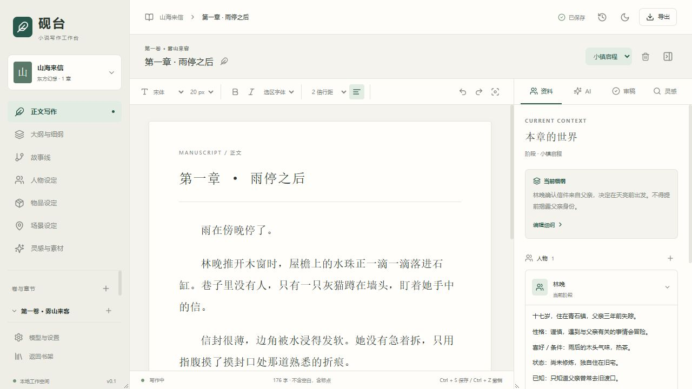

# Yantai 小说写作工作台

Yantai 是一款本地优先的中文小说写作桌面软件，使用 Go + Wails + React + Tiptap + SQLite，提供正文、大纲、细纲、故事线、分阶段设定、AI 辅助、审稿与素材检索。

当前版本为 v0.5.0，优先支持 Windows。发布程序内嵌前端资源，使用时不需要 Node.js、Go 或单独安装数据库；Windows 需要 WebView2，本地 AI 需要另行启动模型服务。

## v0.5.0 更新

- 新增 Linux / Windows Server 服务端，公网仅提供 TLS 加密同步端口，网页工作台可选在内网独立 HTTP 端口开启。
- 客户端可配置服务端地址、手动同步和定时同步，传输完整项目与图片。
- 双端修改提示项目冲突，由作者选择方向；覆盖前保留历史，不自动传播删除。
- AI 审稿支持一键替换有效建议，自动跳过无变化、过期和冲突段落，整批可撤销。
- 大项目草稿改存 IndexedDB，修复浏览器存储配额导致的保存错误。

详见 [v0.5.0 更新说明](docs/releases/v0.5.0.md)。

## 启动

双击 [Yantai.exe](build/bin/Yantai.exe)。书架提供新建小说与示例小说入口。默认数据存放在 build/bin/data，移动程序时请保留旁边的 data 目录。可通过 YANTAI_DATA 环境变量指定数据目录。

另提供 build/bin/Yantai-browser.exe，运行 scripts/browser.ps1 后在浏览器中使用。桌面版与浏览器版默认可指向同一数据目录，多个客户端的旧版本写入会被拒绝。

## 已实现

- 小说书架、新建与切换、卷章管理、章节排序。
- 富文本正文、显示字体字号与行距、选区字体、缩进、深浅主题、专注模式、纯字数、查找替换、空白行清理、正文修改标记与光标/滚动位置恢复。
- 自动保存、未提交草稿恢复、版本冲突检查、项目历史与整体回退。
- 全书总览 / 世界规则 / 文风约定标签、卷纲、阶段细纲、章纲、前情提要、多故事线节点。
- 人物、物品、场景的阶段版本与历史继承，右侧资料及本章上下文勾选，JSON / CSV 设定导入、字段映射、预览与同名处理。
- Ollama 与兼容接口配置、模型连接测试、上下文预览与预算、流式候选、改写差异预览、取消、采纳和撤销，审稿历史本地保存，AI 场景平面图与 SVG 导出。
- 本地常见错别字、文风规则与重复段落检查、AI 文风及一致性审稿、独立来源检测服务适配。
- TXT 和 Markdown 素材导入、本地关键词检索、AI 检索词规划与实际片段检索、向量语义检索、免密钥联网摘要检索、AI 文风描写参考。
- TXT、Markdown、DOCX、EPUB、完整 JSON 项目导出和项目副本导入。

## 服务端与多设备同步

服务端支持 Linux / Windows Server，公网默认只提供 TLS 加密同步端口，不提供网页或登录页；网页工作台可绑定具体内网 IP 的独立 HTTP 端口。Yantai.exe 的模型与设置或书架“服务端同步”入口可配置地址、手动同步和定时同步。两端同时修改时提示项目冲突，不自动覆盖。

部署、HTTPS、开机启动和同步范围详见 [服务端部署与同步](docs/server-sync.md)。

## 当前范围

AI 来源检测需要自行配置支持中文的检测服务，结果不能证明作者身份。首版未捆绑检测器、模型或推理运行时。联网搜索默认使用免密钥 Bing RSS；可选配置 Brave Search API 密钥。

关键词检索无需模型，语义检索需配置支持嵌入接口的向量模型（使用同一模型服务地址）；来源向量按内容在当前进程中缓存。图片栏支持地图、人物、场景及静态 SVG，随完整项目备份保存。场景级独立故事时间属于后续扩展。完整项目 JSON 包含当前支持的全部数据；TXT 与 Markdown 目前不保留富文本格式。

为了先交付可靠的写作流程，每个小说的 SQLite 保存事务化项目快照和历史；细分关系表和更高效的大体量历史存储后续迁移。长篇数据量增加时，完整快照历史会占用较多磁盘空间。

## 开发

安装 Go 1.23 或更高版本、Node.js 与 Wails v2.10.2，然后运行 scripts/build.ps1。前端依赖通过 package-lock.json 固定，Go 依赖通过 go.mod 与 go.sum 固定。

```powershell
./scripts/build.ps1
```

后端测试与静态检查：

```powershell
go test ./...
go vet ./...
```

开发时可先构建前端，再运行 go run ./cmd/server -data build/qa-data -listen 127.0.0.1:48120，另一终端在 frontend 执行 npm.cmd run dev。测试夹具 tests/mock-ai.mjs 只提供明确标记的固定测试文本，不是实际 AI 模型。

## 文档

- [GitHub 调研与选型](docs/research.md)
- [产品功能与技术设计](docs/product-design.md)
- [使用说明](docs/usage.md)
- [功能完成状态](docs/feature-status.md)
- [验证记录](docs/verification.md)


# 更新：Agent 写入与档案字段

支持 [AI Agent 本机接口](docs/agent-api.md)，左侧章节列表可修改章节名，人物基础档案可勾选性别、出生地等常用字段。Agent 更新后，使用顶部刷新按钮读取最新项目。
